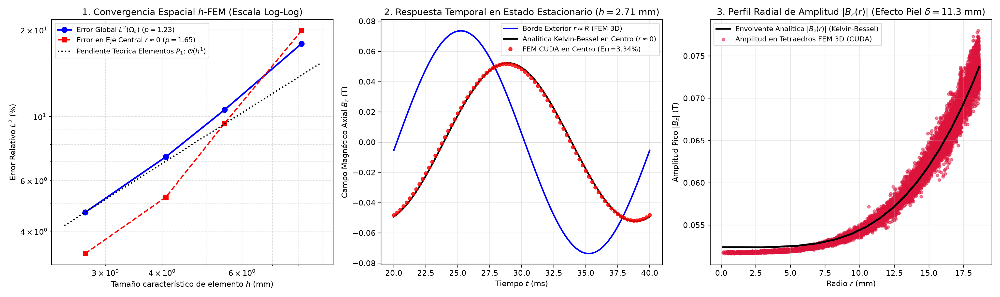
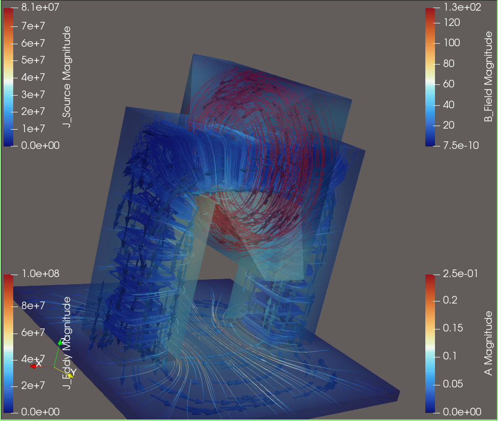
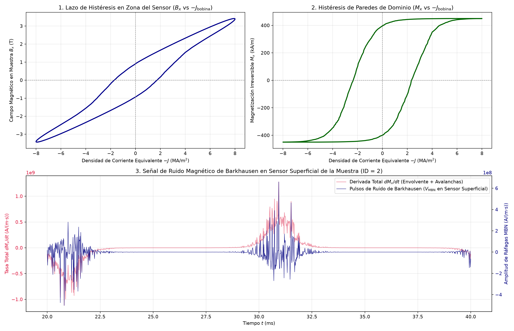
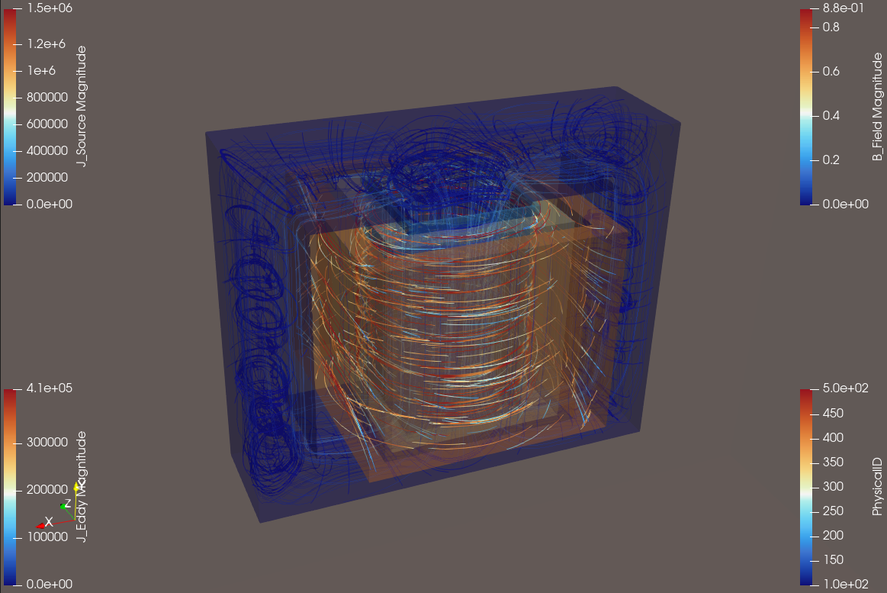
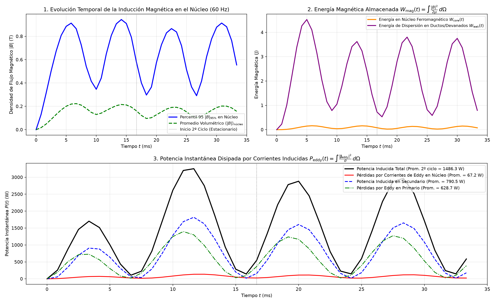

# 3D GPU-Accelerated Finite Element Electromagnetic & Micromagnetic Solver (C++17 / CUDA / Python)


A high-performance, hybrid **C++17 / CUDA / Python** numerical engine for **3D Vector Magnetostatics**, **Transient Quasi-Static Eddy-Current Diffusion**, and **Coupled Stochastic Magnetic Barkhausen Noise (MBN)** simulations on unstructured tetrahedral meshes ($\sim 2.2\times 10^6$ elements, $>10^6$ DOFs, and $>2.3\times 10^7$ micromagnetic domains in VRAM).

> **Note on Repository Scope (Portfolio & Architecture Showcase):**  
> This repository showcases the software architecture, custom RAII memory management (`Buffer<T>`, `Vector`), Compressed Sparse Row (`MatrixCSR`) topological assembly, public C++ API headers (`PhysicsEngine`, `Solver`), Pybind11 zero-copy bridges, and Python simulation workflows developed for my M.Sc. thesis in Electrical Engineering at **IPN - ESIME Zacatenco**.  
> To protect core academic IP prior to final journal publication, the internal implementation files `src/physicsEngine.cpp` and `src/solvers_gpu.cu` are omitted from the public tree; however, the pre-compiled Linux x86_64/CUDA shared library (`fem_simulator.cpython-312-x86_64-linux-gnu.so`) is provided so all Python benchmarks can be executed directly.

---

## Key Engineering Highlights

* **Custom Zero-Overhead C++17 Linear Algebra Core:** Built from scratch using strict RAII, move semantics, Named Return Value Optimization (NRVO), and compile-time integer-underflow traps (`Buffer<T>` and `Vector`) without external heavy template dependencies.
* **Two-Pass Symbolic & Numeric CSR Assembly in C++:** Direct element-to-CSR graph construction (`assemble_topology_elements`) in C++ using fast L1-cached row sweeps and $O(1)$ Lookup Tables (LUT) for multi-region material properties ($\mu_r, \sigma$).
* **100% VRAM-Resident Transient GPU Solver:** Time-stepping loops run entirely inside GPU memory using **NVIDIA cuSPARSE** (SpMV) and **cuBLAS** (`saxpy`, `sdot`, `sscal`) with second-order temporal extrapolation ($\mathbf{A}^{(n)}_0 = 2\mathbf{A}^{(n-1)} - \mathbf{A}^{(n-2)}$), eliminating host-to-device PCIe bottlenecks across thousands of time steps.
* **Multi-Scale Maxwell–ABBM Micromagnetic Coupling:** Couples 3D macroscopic eddy-current fields ($\mathbf{A}$-formulation) with 250 stochastic Alessandro–Beatrice–Bertotti–Montorsi (ABBM) domain-wall pinning states per finite element via custom CUDA kernels.

---

## 1. Mathematical & Physical Verification ($h$-FEM Convergence Benchmark)

The transient eddy-current solver was rigorously validated against the exact analytical **Duhamel–Fourier–Bessel (Kelvin)** series for harmonic magnetic diffusion into a conducting cylinder ($\delta = 11.3\text{ mm}$ at $f = 50\text{ Hz}$) across four progressively refined 3D tetrahedral meshes:

$$\nabla \times \left(\nu \nabla \times \mathbf{A}\right) + \sigma \frac{\partial \mathbf{A}}{\partial t} = \mathbf{J}_s(t)$$



* **Global $L^2(\Omega_c)$ Spatial Convergence Rate:** $p = 1.23$ (exceeding the theoretical $\mathcal{O}(h^1)$ rate for first-order $P_1$ tetrahedral elements).
* **Axial Centerline $L^2(r \approx 0)$ Convergence Rate:** $p = 1.65$, achieving a **$3.34\%$ relative $L^2$ error** in both amplitude attenuation and phase lag on the finest mesh ($h = 2.71\text{ mm}$).

---

## 2. Coupled 3D Magnetic Barkhausen Noise (MBN) Non-Destructive Evaluation

Simulation of a non-destructive testing (NDT) ferromagnetic yoke and surface sensor inspecting a steel plate ($355,423$ nodes, $2,215,077$ tetrahedra, $1,066,269$ DOFs, and **$23,324,250$ concurrent micromagnetic domains** integrated over $2,400$ time steps at $f_s = 60\text{ kHz}$, $\Delta t = 16.67\text{ }\mu\text{s}$):

### 3D Field, Eddy-Current Loops & Vector Potential Distribution (ParaView)


### Macroscopic Hysteresis Loops & Stochastic Barkhausen Avalanche Bursts


* **Physical Fidelity:** Captures the closed sigmoidal ferromagnetic hysteresis loop ($B_x$ and irreversible magnetization $M_x$) alongside the characteristic bell-shaped Barkhausen noise burst envelopes ($dM_x/dt$ and high-frequency $V_{\text{MBN}}$ impulses) centered around the coercive field crossings.

---

## 3. 3D Shell-Type Power Transformer under Nominal Load ($60\text{ Hz}$)

Full 3D transient simulation of a single-phase shell-type transformer including a silicon-steel core ($\mu_r = 2200$), solid pressboard/Nomex bobbin, low-voltage primary winding, high-voltage secondary winding, and mineral oil cooling ducts:

### 3D Magnetic Flux Streamlines & Induced Eddy-Current Loops (ParaView)


### Transient Core Induction, Magnetic Energy Storage & Joule Eddy Losses


* **Electromagnetic Performance:** Resolves the initial energization transient (first cycle) and stationary $2f = 120\text{ Hz}$ power pulsation (second cycle), separating reactive leakage energy stored in the cooling ducts ($W_{\text{leak}}$) from core magnetization energy ($W_{\text{core}}$) and quantifying real-time eddy-current losses ($P_{\text{eddy}} = \int \vert{}\mathbf{J}_{\text{eddy}}\vert{}^2 / \sigma\,d\Omega$).

---

## Repository Structure

```text
├── CMakeLists.txt                 # Cross-architecture C++17 / CUDA build configuration
├── include/
│   ├── buffer.h                   # Custom RAII contiguous memory container with underflow traps
│   ├── vector.h                   # Mathematical vector class with NRVO & move semantics
│   ├── matrixcsr.h                # Compressed Sparse Row (CSR) matrix interface
│   ├── physicsEngine.h            # 3D FEM assembly, LUT materials & post-processing API
│   └── solvers.h                  # CPU & GPU (cuSPARSE/cuBLAS/CUDA) solver interfaces
├── src/
│   ├── bindings.cpp               # Pybind11 zero-copy NumPy <-> C++/CUDA bridges
│   ├── matrixcsr.cpp              # CSR prefix-sum builder, column sorting & SpMV
│   ├── solvers_cpu.cpp            # Reference CPU Conjugate Gradient solver
│   └── vector.cpp                 # Vector arithmetic & linear algebra implementation
│   # [Note: physicsEngine.cpp & solvers_gpu.cu are omitted in this public demo]
├── python/
│   ├── validate_transient.py      # Analytical Kelvin-Bessel h-FEM convergence study
│   ├── barkhausen.py              # Coupled 3D Eddy-Current + Stochastic ABBM Barkhausen solver
│   ├── transient_transformer.py   # 3D shell-type power transformer transient analysis
│   ├── transient.py               # General transient eddy-current workflow (.pvd/.vtu export)
│   ├── static.py                  # 3D vector magnetostatics solver workflow
│   └── msh/
│       ├── BarkhausenFinal.geo    # OpenCASCADE geometry for the MBN sensor yoke & sample
│       └── transformer.geo        # Conformal OpenCASCADE geometry for the 3D transformer
└── docs/
    └── images/                    # High-resolution validation plots and ParaView renders